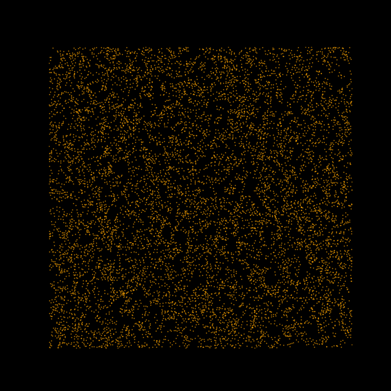
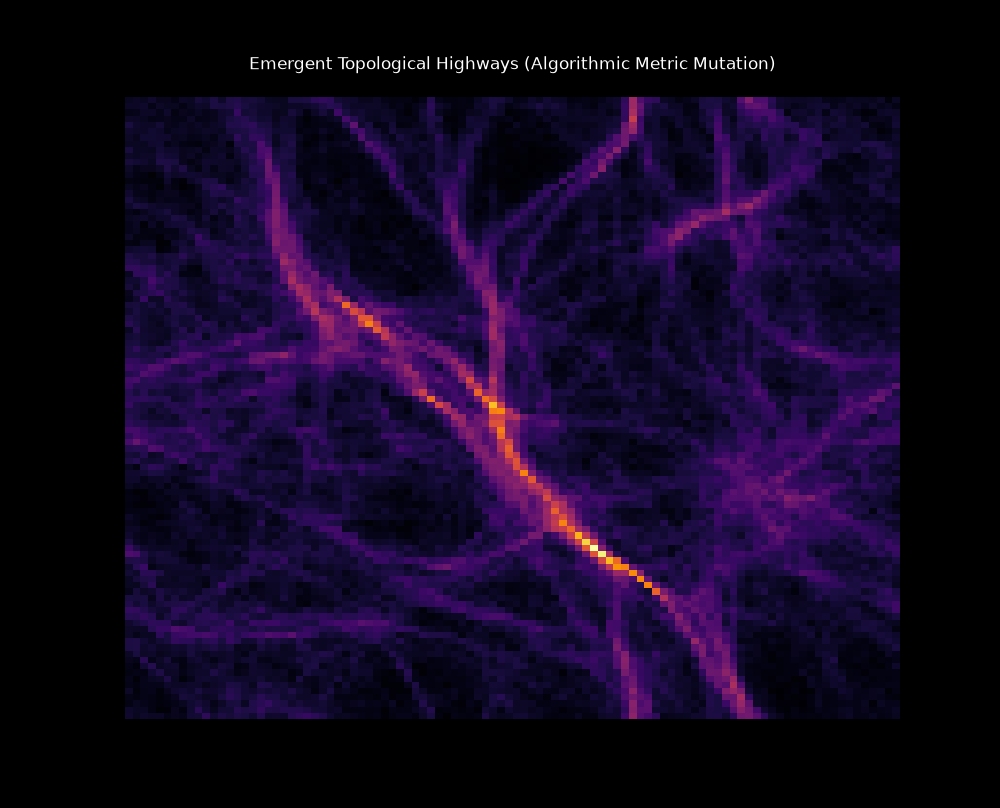
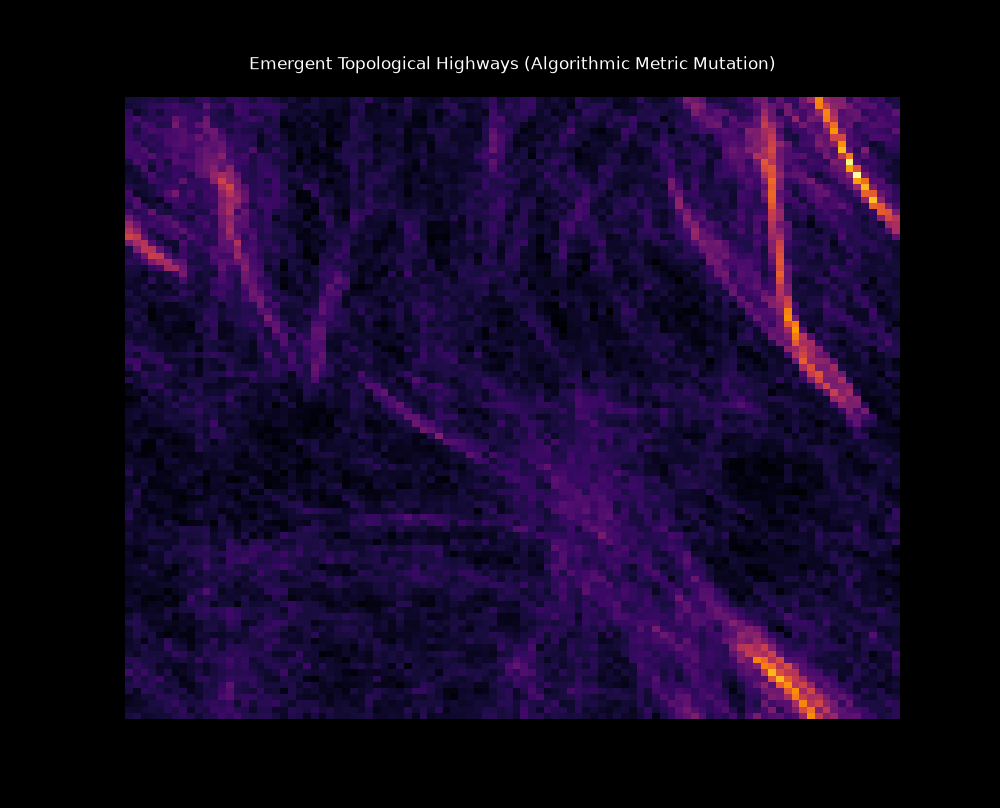
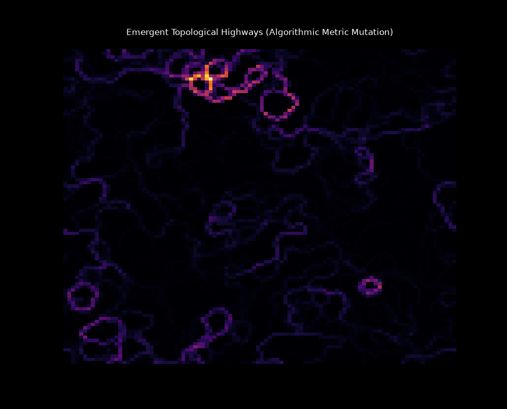
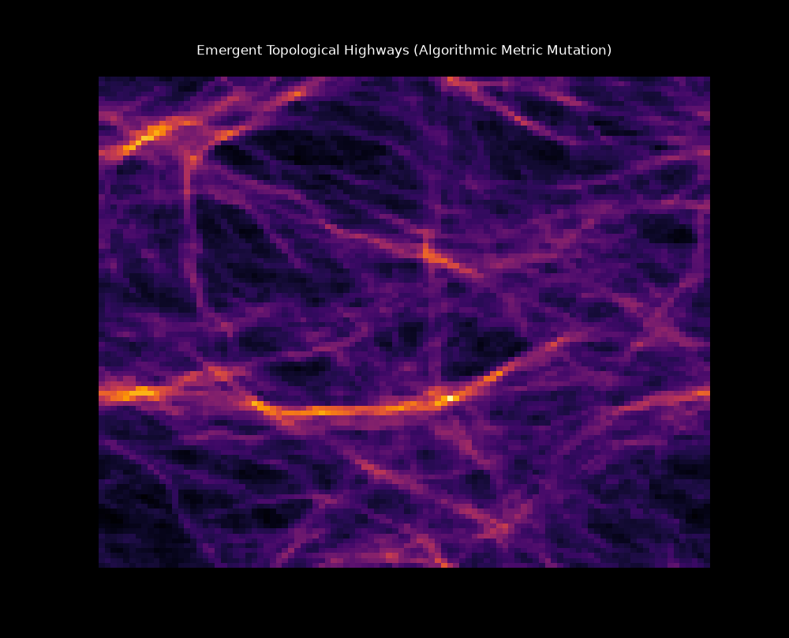

# Discrete Manifold Sandbox: Emergent Topological Highways

An execution-based computational physics engine designed to bypass the circular dependency paradox of dynamic metric tensors using discrete differential geometry.



*Above: Spontaneous symmetry breaking and the emergence of vascular topologies from maximum entropy.*

## The Problem: The Infinite Regress Paradox
In classical continuous differential geometry, modeling a self-modifying space—where a moving vector ($V$) alters the metric tensor ($g$), and the metric tensor simultaneously dictates the path of the vector—results in an analytical infinite regress. You cannot calculate the continuous rate of change of the space without knowing the exact path of the vector, and vice versa. 

Attempting to solve this via traditional master equations typically results in singularities or chaotic mathematical explosions. 

## The Solution: Execution over Algebra
Instead of attempting to write a closed-form analytical formula to predict the final state of the manifold, this engine treats space as a discrete computational process. It bypasses the continuous calculus dead-end by implementing local, bounded geometric rules and relying on computational irreducibility to reveal the macroscopic structure.

### The "Slime & Mirrors" Architecture
The space is initialized as a 2D grid of unit vectors (normals/mirrors). Particles (vectors) traverse this space governed by two strict architectural rules:

1. **Geometric Refraction & Merge:** When a particle interacts with the local metric, it does not calculate an unknown continuous rate of change. It undergoes a strict geometric projection onto the local plane. This forces the vector to merge its momentum with the space, organically preventing infinite energy scaling.
2. **Bounded Metric Mutation:** The space reacts to the particle's passing by tilting its local normal in the direction of the merge. This is governed by a bounded differential (`EPSILON`). The space mutates, but the underlying tensor fabric remains unbroken.

By firing stochastic paths through these local constraints, the system acts as a Markov process that naturally carves out the exact topological attractors of the space.

## Visual Proof & Topological Phase Transitions

By altering the fundamental hyperparameters (`EPSILON` and `MOMENTUM`), the engine reliably maps discrete topological phase transitions:

### 1. The Highway Emergence


At stable parameters (`EPSILON = 0.05`), the random static of the starting grid collapses. Particles negotiate a path of least geometric friction, spontaneously squeezing the 2D space into 1D superhighways (eigenvalue separation/dimensional collapse).

### 2. The Shatter-Point (Topological Boiling)


By increasing the mutation rate (`EPSILON = 0.9`), the feedback loop overcorrects violently. The metric tears itself apart before stable geodesics can form, proving the boundaries of the bounded merge.

### 3. Absolute Zero Inertia (The Crystal Lattice)


By killing the momentum of the particles (`MOMENTUM = 0.05`), the vectors become trapped by the local mirrors. The space gridlocks into rigid, closed geometric cages and cellular loops.

### 4. The Particle Flood (Fluid Dynamics)


Flooding the system with 10x the particles at a lower mutation rate (`EPSILON = 0.01`) widens the sharp geodesics into turbulent, thick rivers, demonstrating emergent fluid dynamics within the tensor field.

## Getting Started

### Prerequisites
You need a Python environment with PyTorch and Matplotlib installed. The script will automatically utilize a CUDA-enabled GPU if one is available on your workstation.

```bash
pip install torch matplotlib numpy
```

### Running the Live Simulation
The main script runs an interactive Matplotlib window where you can watch the vascular structures emerge frame-by-frame from pure static noise.

```bash
python emergent_manifold.py
```
*(Note: If you encounter OpenMP library clashes on Windows, ensure `os.environ['KMP_DUPLICATE_LIB_OK'] = 'True'` remains at the top of the script).*

## Conclusion
This sandbox proves a fundamental sufficiency theorem: **You do not need complex, pre-calculated global equations to generate stable, high-dimensional structures.** Simple, local geometric friction—when allowed to execute over time—is entirely sufficient to spontaneously generate them. 
